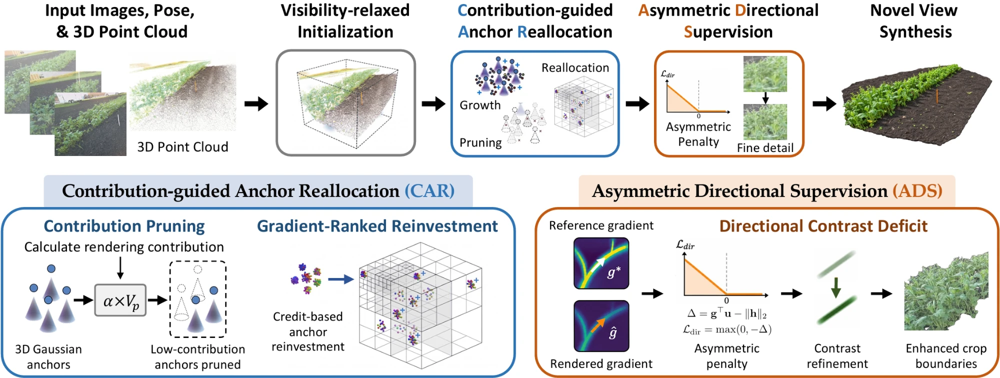

# 🌱 AgriSplat Overview

<p align="center">
  
</p>

## 1. Method Description

**AgriSplat** is a reconstruction method for **fine-detail rendering of field-grown crops**, evaluated on the AgriChrono NVS benchmark.  
It combines two components:  
- **Contribution-guided Anchor Reallocation (CAR)**: relaxes initial visibility filtering, prunes low-contribution anchors, and reinvests the resulting credit into sub-threshold candidates ranked by gradient magnitude  
- **Asymmetric Directional Supervision (ADS)**: after anchor growth and reallocation have ended, penalizes insufficient rendered contrast along reference image-gradient directions under a fixed anchor topology  

Averaged over the seven scenarios, AgriSplat improves the crop-region gradient-energy ratio (GER<sub>C</sub>) from 0.506 to 0.847 and the edge F-score (EdgeF<sub>C</sub>) from 0.712 to 0.797 over Octree-GS, together with whole-image PSNR, SSIM, and LPIPS.

**Training setup**  
- 40,000 iterations (same schedule as the Octree-GS baseline)  
- Anchor growth and pruning end at iteration 25,000; ADS runs for the remaining 15,000 iterations  
- Results are averaged over three random seeds (0, 1, 2)  
- Mean training-loop time 17m 58s and peak GPU memory 6,258 MB per scenario on an NVIDIA RTX 6000 Ada


---

## 2. Modular Architecture

- **Visibility-relaxed Initialization**  
  - Anchors selected by at least one training camera are kept (Octree-GS filters them more strictly)  
  - Preserves fine-level anchor candidates for thin crop structures  

- **Contribution Pruning (CP)** — `utils/agrisplat_cp.py`  
  - Rendering contribution of each anchor is measured and low-contribution anchors are pruned  
  - Pruning rounds every 5,000 iterations until iteration 25,000  

- **Gradient-Ranked Reinvestment (GR)** — `utils/agrisplat_gr.py`  
  - Credit released by pruning is reinvested into eligible sub-threshold candidates ranked by gradient magnitude  
  - Total anchor budget stays bounded  

- **Asymmetric Directional Supervision (ADS)** — `utils/loss_utils.py` (`ads_loss`)  
  - One-sided penalty on luminance gradients: only insufficient contrast along the reference gradient direction is penalized  
  - Applied from iteration 25,000 with the anchor topology fixed  

- **Evaluation tools** — `eval_bench.py`, `metrics_all.py`  
  - Renders the test views and computes PSNR<sub>W</sub>, SSIM<sub>W</sub>, LPIPS<sub>W</sub>, SSIM<sub>C</sub>, LPIPS<sub>C</sub>, GER<sub>C</sub>, EdgeF<sub>C</sub>, training time, and peak GPU memory  

---

## 3. Directory Summary

| Path | Description |
|------|-------------|
| [`train.py`](./train.py) | Training entry point (Octree-GS based, with CP / GR / ADS options) |
| [`utils/agrisplat_cp.py`](./utils/agrisplat_cp.py) | Contribution Pruning |
| [`utils/agrisplat_gr.py`](./utils/agrisplat_gr.py) | Gradient-Ranked Reinvestment |
| [`utils/loss_utils.py`](./utils/loss_utils.py) | Losses, including the ADS loss |
| [`utils/vram_monitor.py`](./utils/vram_monitor.py) | Peak GPU memory monitor |
| [`eval_bench.py`](./eval_bench.py) | Renders the benchmark test views |
| [`metrics_all.py`](./metrics_all.py) | Whole-image and Canola Region metrics, per-scene and summary tables |
| [`scripts/`](./scripts) | `train_eval.sh` (one scene) and `run_all.sh` (seven scenarios) |
| [`tests/`](./tests) | Unit tests of the added modules |
| [`MANIFEST/`](./MANIFEST) | Change log and checksums of the files modified from Octree-GS |

---

## 4. Installation

```bash
conda env create -f environment.yml
conda activate agrisplat
TORCH_CUDA_ARCH_LIST="8.0;8.6;8.9;9.0+PTX" pip install --no-build-isolation submodules/diff-gaussian-rasterization submodules/simple-knn   # needs a CUDA 12.x nvcc
```

---

## 5. Data

Download the benchmark dataset (see [`../benchmark/README.md`](../benchmark/README.md)) and place the seven scenarios at `./datasets` (or pass `--data_root DIR` / set `AGRISPLAT_DATA=DIR`):

```swift
datasets/
  Table1/06  Table1/11  Table1/16  Table1/21          ← Lighting Variance (Day 19: 06:00, 11:00, 16:00, 21:00)
  Table2/Week1  Table2/Week2  Table2/Week3            ← Growth Span (Day 6, 13, 20)
    each: images/  sparse/  train_list.txt  test_list.txt  mask/
```

The Canola Region metrics use the canola masks (`mask/<frame>.png`, Canola = yellow `250,250,55`), which are included in the benchmark dataset.  
If the masks are elsewhere, pass `--mask_root DIR` (masks at `DIR/<scene>/<frame>.png`) to `metrics_all.py`, or set `MASK_ROOT=DIR` for the scripts.

---

## 6. Run

Variants: `nf`, `cp`, `cpgr`, `ads`, `full` (AgriSplat).

```bash
bash scripts/train_eval.sh full Table2/Week3        # one scene: train, render test views, metrics
bash scripts/run_all.sh full                        # all seven scenarios (finished scenes are skipped) + summary
```

Steps of one scene (`outputs/Table2/Week3/full/`):

```bash
python train.py --eval -s Table2/Week3 -m outputs/Table2/Week3/full     # train (see train_eval.sh for the settings)
python eval_bench.py -m outputs/Table2/Week3/full                       # render the test views to bench/
python metrics_all.py --scene Table2/Week3 --variant full               # metrics -> results.json
python metrics_all.py --summary --variant full                          # table + outputs/summary_full.csv
```

`results.json` holds PSNR_W, SSIM_W, LPIPS_W, SSIM_C, LPIPS_C, GER_C, EdgeF_C, the training-loop time
(`train_loop_s`, `train_loop_mmss`; without data loading, test renders and saving), peak VRAM (`peak_vram_nvml_gb` as
seen by nvidia-smi, `peak_vram_gb` = torch max_memory_allocated), the final anchor count `n_anchors` and `gpu`. The
summary has one row per scenario and a Mean row with PSNR_W, SSIM_W, LPIPS_W, SSIM_C, LPIPS_C, GER_C, EdgeF_C,
Time_min and VRAM_GB (NVML peak).

---

## 7. Options

| option                 | default      | meaning                                                |
|------------------------|--------------|--------------------------------------------------------|
| `--cp`                 | 1            | Contribution Pruning on / off                          |
| `--gr`                 | 1            | Gradient-Ranked Reinvestment on / off (needs `--cp 1`) |
| `--ads`                | 1            | Asymmetric Directional Supervision on / off            |
| `--cp_threshold`       | 8.0          | contribution threshold (pixel-equivalents)             |
| `--cp_interval`        | 5000         | iterations between pruning rounds                      |
| `--cp_until`           | 25000        | last pruning round and end of reinvestment             |
| `--gr_credit_fraction` | 1.0          | fraction of the removed anchors reinvested             |
| `--ads_start`          | 25000        | first iteration of ADS                                 |
| `--ads_weight`         | 1.0          | ADS weight                                             |
| `--seed`               | 0            | random seed                                            |
| `--data_root`          | `./datasets` | dataset root                                           |

Example: `bash scripts/train_eval.sh full Table2/Week3 1 --cp_threshold 4 --ads_weight 0.5` (seed 1, output
`outputs/Table2/Week3/full_s1/`).

---

## 8. License & Acknowledgements

AgriSplat is built on [Octree-GS](https://github.com/city-super/Octree-GS), which builds on [3D Gaussian Splatting](https://github.com/graphdeco-inria/gaussian-splatting).  
This directory derives from them and follows the [Octree-GS license](https://github.com/city-super/Octree-GS/blob/main/LICENSE.md) (Gaussian-Splatting License; non-commercial research and evaluation use), which differs from the license of the rest of this repository.

---

## **📜 Citation**
```tex
@article{jeong2025agrichrono,
  title={AgriChrono: A Longitudinal Dataset and Benchmark for Novel-View Synthesis of Field-Grown Crops},
  author={Jeong, Jaehwan and Vu, Tuan-Anh and Jony, Mohammad and Ahmad, Shahab and Rahman, Md. Mukhlesur and Kim, Sangpil and Jawed, M. Khalid},
  journal={arXiv preprint arXiv:2508.18694},
  year={2025},
}
```
