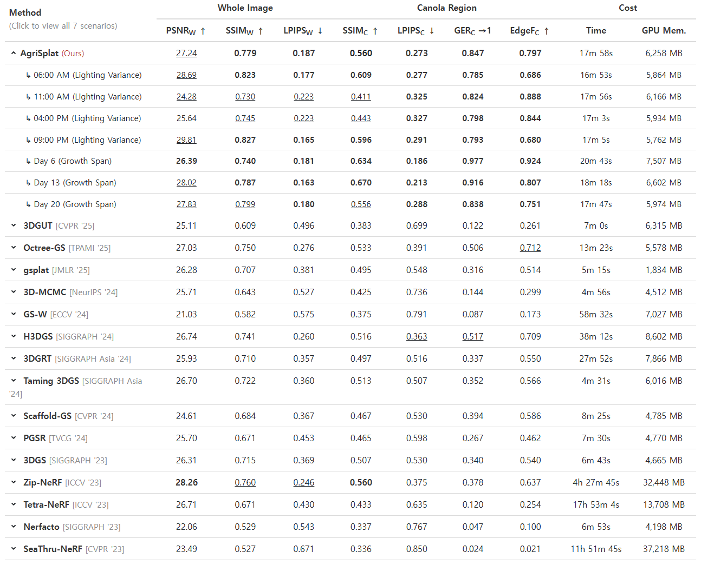
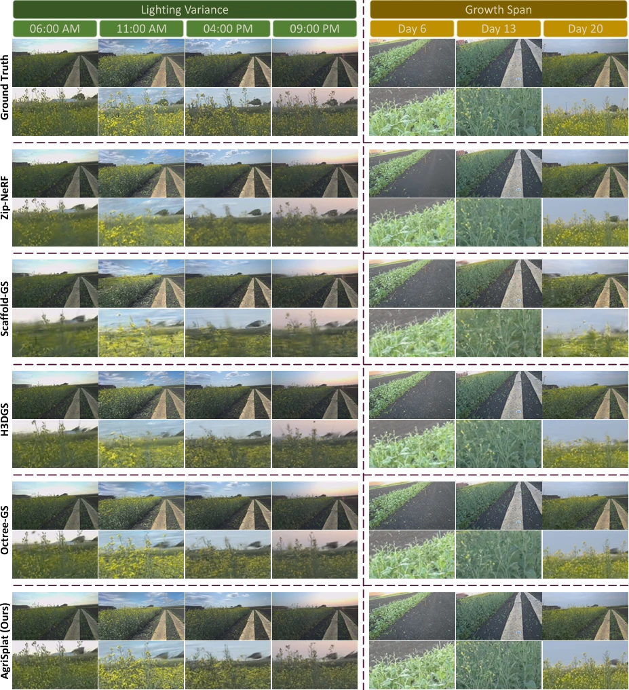

# 📊 Benchmark & Evaluation


## 1. What is this Benchmark?
We benchmark Novel View Synthesis on AgriChrono with **15 baseline methods and AgriSplat** across **Seven Scenarios** characterized by **Lighting Variance** and **Growth Span**. Each scenario comprises 400 images (960×540) partitioned into 350 for training and 50 for testing. This benchmark assesses the robustness of methods against drastic **illumination changes** and **morphological variations** of **non-rigid objects** in unstructured outdoor environments.

---

## 2. Data Preparation & Evaluation Protocol 

<p align="center">
  
</p>

### 📂 **[Download Benchmark Dataset](https://ucla.box.com/s/xemhedod23tnimcvkou6kbupay3kpue1)**  

### Dataset Overview

- **Coverage**: Seven scenarios from the counterclockwise (CCW) traversals at Site 1: four **Lighting Variance** sessions (Day 19 at 06:00, 11:00, 16:00, 21:00) and three **Growth Span** sessions (06:00 on Days 6, 13, 20).
- **Sampling**: Every seventh frame of the left RGB stream of ZED-L, giving a batch of 400 frames per scenario with a uniform spatial interval of ∼9 cm.

### Data Structure (COLMAP Format)

The benchmark dataset is provided as a `.tar` archive. After extraction, it is organized as follows:

```text
datasets/
├── 1_resize_files.py
├── 2_train_test_split.sh
├── 3_colmap_generate.py
├── Table1/                  # Lighting Variance (Day 19)
│   └── [scenario]/          # 06, 11, 16, 21 (hour of day)
└── Table2/                  # Growth Span (06:00)
    └── [scenario]/          # Week1, Week2, Week3 (Day 6, 13, 20)
        ├── raw/             # Original frames
        ├── images/          # Resized images (960 × 540)
        ├── depth/           # Depth maps
        ├── mask/            # Canola-region masks (test frames)
        ├── sparse/          # COLMAP sparse model (binary)
        ├── sparse_txt/      # COLMAP sparse model (text)
        ├── pose_info.csv    # Camera poses
        ├── train_list.txt   # 350 training frames
        └── test_list.txt    # 50 test frames
```

- **RGB Images**: Resized to 960 × 540 resolution.
- **Camera Intrinsics**: Corresponding intrinsic camera parameters included.
- **3D Point Cloud**: Initial point cloud generated by sampling 0.1% of the depth points of the training frames.
- **Camera Extrinsics**: Extrinsic camera pose derived from VIO.
- **Canola-region Masks**: Manually annotated masks of the 50 test images per scenario.

### Experimental Setup (Novel View Synthesis)

- **Protocol**: Each scenario is reconstructed independently from its training images and VIO camera poses; the benchmark evaluates held-out-view rendering within individual traversals.
- **Baselines**: 15 methods (11 Gaussian Splatting-based and four NeRF-based), run with NerfBaselines v1.2.12 and default training configurations. **AgriSplat** is evaluated with three random seeds and averaged.
- **Data Split**:
  - **Training**: 350 images
  - **Testing**: 50 uniformly distributed held-out images
- **Evaluation Metrics**:
  - **Whole Image**: PSNR<sub>W</sub>, SSIM<sub>W</sub>, LPIPS<sub>W</sub> (AlexNet)
  - **Canola Region** (manually annotated masks): SSIM<sub>C</sub>, LPIPS<sub>C</sub>, GER<sub>C</sub> (Gradient-Energy Ratio, best at 1), EdgeF<sub>C</sub> (Edge F-score, 2 px tolerance)
  - **Cost**: training time and peak GPU memory (NVIDIA RTX 6000 Ada)

---

## 3. Benchmark Results

> **Note**: These results can be viewed more conveniently on the [**Project Page**](https://jaehwan-j.github.io/agrichrono/).

### 🔹 Quantitative Results

<p align="center">
  
</p>

### 🔹 Qualitative Results

<p align="center">
  
</p>


---

## **📜 Citation**  
```tex
@article{jeong2025agrichrono,
  title={AgriChrono: A Longitudinal Dataset and Benchmark for Novel-View Synthesis of Field-Grown Crops},
  author={Jeong, Jaehwan and Vu, Tuan-Anh and Jony, Mohammad and Ahmad, Shahab and Rahman, Md. Mukhlesur and Kim, Sangpil and Jawed, M. Khalid},
  journal={arXiv preprint arXiv:2508.18694},
  year={2025},
}
```