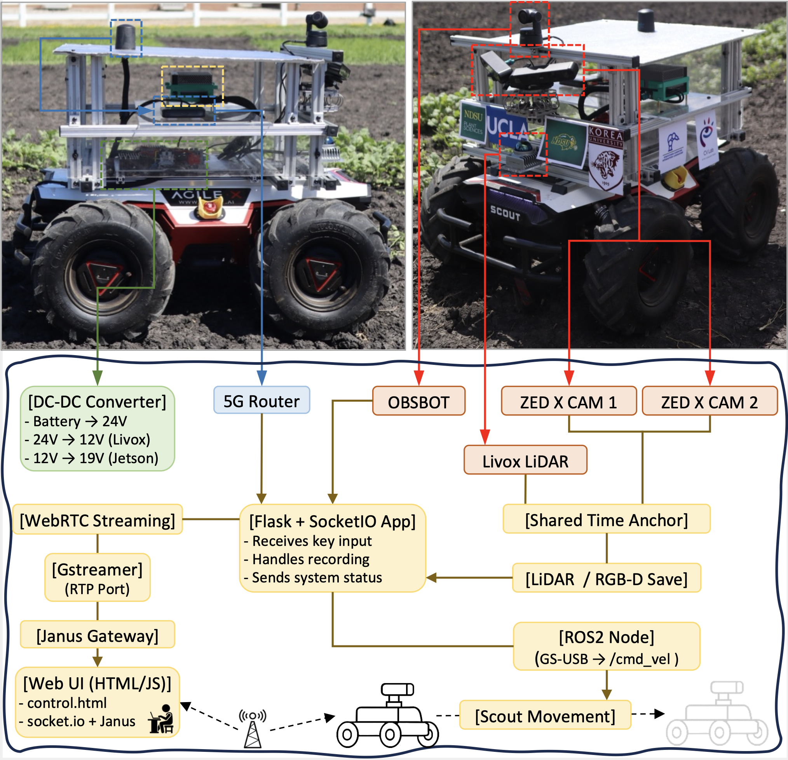

# 💻 Software Overview

## 1. System Description

<table>
<tr>
<td width="55%" valign="top">

The software stack enables **multi-modal sensing, control, and remote operation** on a **Jetson AGX Orin 64GB**.  
It provides:  
- Synchronized RGB-D + LiDAR + IMU logging  
- CAN-based AGV control (AgileX Scout 2.0)  
- Low-latency WebRTC streaming with browser teleoperation  
- Automated data offload and network reporting  

Each module is self-contained and ships with an **`.sh` auto-installer** for one-command setup, ensuring quick deployment.

**Environment & Versions**  
- **JetPack 6.2 (L4T 36.4.3)** with **ROS 2 Humble**  
- **ZED**: [ZED Link Duo v1.3.0](https://www.stereolabs.com/docs/embedded/zed-link/install-the-drivers) + [ZED SDK v5.0.2](https://www.stereolabs.com/developers/release)  
- **Livox**: SDK2 (latest) with custom `recorder_sync.cpp` for synchronized logging  
- **Kernel module**: `gs_usb` (externally built for L4T 36.4.3)  

</td>
<td width="45%">



</td>
</tr>
</table>

---

## 2. Modular Architecture

- **1_janus-streaming — Remote Teleoperation**  
  - WebRTC (Janus + GStreamer) for low-latency video  
  - Flask-SocketIO browser UI for PTZ, Scout teleop, system monitoring, and synchronized recording  
  - Safe key release on blur/disconnect  

- **2_scout-ros2-control — Robot Control (CAN + ROS 2)**  
  - Based on [AgileX scout_ros2](https://github.com/agilexrobotics/scout_ros2)  
  - `ugv_sdk` patched for Ubuntu 22.04 / ROS 2 Humble ([patch ref](https://github.com/lucaslins0035/scout_ros2/commit/f0facda7757d75bc0336d700b2f5ae9f384b42f3))  
  - `gs_usb` kernel module built externally for JetPack 6.2  

- **3_zed-data-tools — RGB-D Logging**  
  - Dual ZED X capture to `.svo2` (L/R) + IMU CSV  
  - Dependencies: `zedlink-duo_1.3.0` + ZED SDK 5.0.2  
  - Typical: HD1080 @ 15 FPS, Depth=NEURAL, Compression=LOSSLESS  

- **4_livox-data-tools — LiDAR Logging**  
  - Based on [Livox-SDK2](https://github.com/Livox-SDK/Livox-SDK2)  
  - Custom `recorder_sync.cpp` generates:  
    - `pointcloud_sync.bin` (XYZ + intensity)  
    - `imu_sync.bin` (accel + gyro)  
  - Aligned to `sync_time.txt`  

- **5_systemd — Data Services**  
  - External HDD auto-transfer (`transfer.py` + udev/systemd)  
  - Cloud backup (Box) via `rclone` systemd mount  

- **6_network — Connectivity Services**  
  - Boot-time service emails Jetson IPs, Wi-Fi SSID, and link speed for headless deployments  

---

## 3. Software Modules (Summary)

| Directory | Description |
|-----------|-------------|
| [`1_janus-streaming/`](./1_janus-streaming) | WebRTC streaming + teleop UI (Janus, Flask, Socket.IO) |
| [`2_scout-ros2-control/`](./2_scout-ros2-control) | ROS 2 CAN control (AgileX stack, patched `ugv_sdk`, gs_usb for L4T 36.4.3) |
| [`3_zed-data-tools/`](./3_zed-data-tools) | Dual ZED X RGB-D logger (`.svo2` + IMU CSV) |
| [`4_livox-data-tools/`](./4_livox-data-tools) | Livox Mid-360 LiDAR + IMU logger (SDK2 + custom recorder) |
| [`5_systemd/`](./5_systemd) | External HDD auto-transfer + rclone Box mount |
| [`6_network/`](./6_network) | Boot-time IP/SSID/link-speed email notifier |


---

## 4. Directory Structure (top-level)

```swift
AgriChrono/
├── 1_janus-streaming/
│   ├── install_janus.sh
│   ├── control.html
│   └── control_server.py
├── 2_scout-ros2-control/
│   ├── install_scout_ros2.sh
│   └── ros2_ws/
│       └── src/ (scout_base, scout_description, scout_msgs, ugv_sdk)
├── 3_zed-data-tools/
│   └── data_svo_sync.py
├── 4_livox-data-tools/
│   ├── install_livox_sdk2_sync.sh
│   └── Livox-SDK2/record_lidar_sync/recorder_sync.cpp
├── 5_systemd/
│   ├── install_transfer_service.sh
│   ├── setup_rclone_box_service.sh
│   └── transfer.py
├── 6_network/
│   ├── create_sendip_service.sh
│   └── send_ip_email.py
└── data/
    └── (site1-1, site1-2, site2, site3, ...)
```

---

## 5. Synchronized Data Layout

``` swift
/fargo/<site>/<YYYYMMDD_HHMM>/
├── sync_time.txt
├── RGB-D/
│   ├── L.svo2
│   ├── R.svo2
│   ├── L_info.csv
│   └── R_info.csv
└── LiDAR/
    ├── pointcloud_sync.bin
    └── imu_sync.bin
```

---

## 6. Safety & Ops

- **Fail-safe teleop**: browser blur/disconnect clears keys and sends zero Twist.  
- **Network watchdogs**: boot-time IP email; easy remote access without GUI.  
- **Hands-off data management**: plug-and-go HDD offload + Box cloud mount.

---

## 7. How to run
1. Start the Janus Server (Terminal)
``` bash
janus
```
2. Access the Control Panel (Browser)
``` html
http://[SERVER_IP_ADDRESS]:8000/control.html
```

## **📜 Citation**  
```tex
@article{jeong2025agrichrono,
  title={AgriChrono: A Longitudinal Dataset and Benchmark for Novel-View Synthesis of Field-Grown Crops},
  author={Jeong, Jaehwan and Vu, Tuan-Anh and Jony, Mohammad and Ahmad, Shahab and Rahman, Md. Mukhlesur and Kim, Sangpil and Jawed, M. Khalid},
  journal={arXiv preprint arXiv:2508.18694},
  year={2025},
}
```